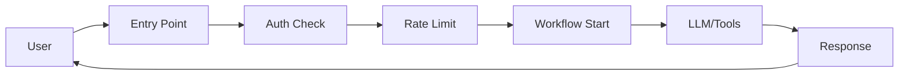

# Product Site and Documentation Improvement Plan

## Problem Statement

Current state:
- ❌ Technical docs (MkDocs) not user-friendly for business stakeholders
- ❌ No clear "what is the-M" landing page with visuals
- ❌ Complex concepts (multi-tenancy, auth, apps, entry points) not explained simply
- ❌ Technical docs mixed with product information
- ❌ No place to embed demo videos or animations

**Goal:** Separate product site (marketing/business) from technical documentation (developers).

---

## Proposed Structure

```
┌─────────────────────────────────────────────────────────┐
│  PRODUCT SITE (Business-Friendly)                       │
│  URL: https://the-m.io or separate subdomain            │
│  ├─ Home (What is the-M)                                │
│  ├─ Features & Capabilities                             │
│  ├─ Use Cases                                           │
│  ├─ Getting Started (Business View)                     │
│  ├─ Concepts Explained (Multi-tenancy, Auth, etc.)     │
│  └─ Demo Video (embedded animation)                     │
└─────────────────────────────────────────────────────────┘
                              ↓ Link
┌─────────────────────────────────────────────────────────┐
│  TECHNICAL DOCS (Developer Reference)                    │
│  URL: https://aviciot.github.io/theM/                   │
│  ├─ Architecture                                        │
│  ├─ API Reference                                       │
│  ├─ Database Schema                                     │
│  ├─ Development Guides                                  │
│  └─ Code Findings Backlog                              │
└─────────────────────────────────────────────────────────┘
```

---

## Product Site Content Plan

### 1. **Homepage** (What is the-M)
**Audience:** Business users, product managers, decision-makers

**Content:**
- Hero section with tagline: "Build AI Agent Workflows Without Code"
- **Embedded animation video** (provided by user)
- 3 key value propositions:
  - Visual workflow builder
  - Multi-tenant security
  - Production-ready orchestration
- "Get Started" CTA → Tutorial
- "Technical Docs" link → Developer docs

**Visuals:**
- Hero image/video
- Feature icons
- Customer logos (if applicable)

---

### 2. **Features & Capabilities**
**Audience:** Technical buyers, architects

**Sections:**

#### **Visual Agent Builder**
- Drag-and-drop workflow creation
- Screenshot/GIF of Agent Canvas
- Node types: LLM, HTTP, Conditions, Human-in-Loop
- No code required

#### **Multi-Tenancy & Security**
**Business explanation:**
> "Each customer gets isolated workspace. One tenant cannot see another's data, workflows, or API keys. Built-in row-level security ensures complete isolation."

**Diagram:** Show tenant isolation visually

**Key points:**
- Row-Level Security (RLS) at database level
- Separate Redis keys per application
- Per-tenant rate limits and quotas
- Cost tracking per tenant

#### **Authentication & User Management**
**Business explanation:**
> "Support multiple authentication methods: Dashboard users with JWT, external SSO integration, API tokens, or public (no auth) endpoints."

**Diagram:** Auth flow diagram

**Options explained:**
- `user_jwt` - Dashboard users (email/password)
- `external_jwt` - SSO integration (OIDC)
- `token` - API access with bearer tokens
- `public` - No authentication (webhooks, public endpoints)

#### **Applications & Entry Points**
**Business explanation:**
> "An **Application** is one AI product (e.g., 'Customer Support Bot'). Each application has **Entry Points** - different ways users can interact with it."

**Visual diagram:**
```
Application: "Customer Support Bot"
├─ Entry Point: "chat-widget" (WebSocket)
├─ Entry Point: "api-v1" (REST API)
├─ Entry Point: "voice-hotline" (Voice)
└─ Entry Point: "slack-integration" (A2A)
```

**Entry Point options:**
- **WebSocket** - Real-time chat
- **SSE** (Server-Sent Events) - Streaming responses
- **A2A** (Agent-to-Agent) - API for other agents
- **Voice** - Phone/voice integration

**Configuration per Entry Point:**
- Max concurrent sessions
- Authentication method
- Rate limits
- Required roles

#### **LLM Gateway**
**Business explanation:**
> "Unified access to multiple AI models. Switch between Claude, GPT, or other LLMs without code changes. Built-in cost tracking and governance."

**Features:**
- Multi-provider support (Claude, GPT, custom)
- Per-tenant API keys
- Cost tracking per request
- Governance policies (max tokens, logging)

#### **Agent-to-Agent (A2A) Protocol**
**Business explanation:**
> "Agents can call other agents. Build specialized agents that work together."

**Example:**
```
User Request → "Customer Support Agent"
                ↓ needs to check inventory
                calls → "Inventory Agent"
                ↓ needs pricing
                calls → "Pricing Agent"
                ↓ returns combined result
                → User
```

---

### 3. **Use Cases**
**Audience:** Business stakeholders, product teams

**Examples:**
- **Customer Support Automation** - Multi-turn conversation with CRM integration
- **Document Processing** - Extract, validate, route documents
- **Sales Assistant** - Lead qualification, meeting scheduling
- **Internal Tools** - Employee onboarding, IT helpdesk

Each with:
- Problem statement
- How the-M solves it
- Workflow diagram
- ROI/benefits

---

### 4. **Getting Started (Business View)**
**Audience:** Product managers, business analysts

**Content:**
1. **Watch the demo** (embedded video)
2. **Understand key concepts** (link to concepts page)
3. **Try the Agent Canvas** (link to sandbox/demo)
4. **Deploy your first workflow** (simplified tutorial)
5. **Need technical help?** → Link to developer docs

---

### 5. **Concepts Explained Simply**

#### **Multi-Tenancy**
**Question:** "How do we keep customer data separate?"

**Answer:**
> "Every customer (tenant) has complete data isolation. Think of it like separate buildings - even if they're on the same street, you can't see into another building."

**Technical translation:** Row-Level Security (RLS), tenant-scoped Redis keys, per-tenant quotas

**Diagram:** Visual showing tenant A and tenant B completely isolated

---

#### **Authentication**
**Question:** "How do users log in?"

**Answer:**
> "Four options based on your needs:
> 1. **Dashboard users** - Email/password (built-in)
> 2. **SSO** - Use your existing login system (OIDC)
> 3. **API keys** - For programmatic access
> 4. **Public** - No login required (webhooks)"

**When to use which:** Decision tree diagram

---

#### **Applications vs Entry Points**
**Question:** "What's the difference?"

**Answer:**
> "An **Application** is the AI workflow itself (the 'what'). **Entry Points** are how users access it (the 'how').
>
> Example: Your 'Customer Support Bot' application might have:
> - A chat widget entry point (WebSocket)
> - An API entry point (REST)
> - A voice entry point (phone calls)
>
> Same AI logic, different access methods."

**Diagram:** One application, multiple entry points

---

#### **Workflows (AppFlow)**
**Question:** "How do I build logic?"

**Answer:**
> "Drag and drop nodes on a canvas:
> - **LLM nodes** - Ask AI questions
> - **Condition nodes** - If/else logic
> - **HTTP nodes** - Call external APIs
> - **Human-in-Loop** - Wait for approval
> - **Agent Call** - Call another AI agent"

**Screenshot:** Agent Canvas with sample workflow

---

### 6. **Technical Architecture (High-Level)**
**Audience:** Technical architects, CTOs

**Simple diagrams:**
- System overview (services, databases)
- Request flow (user → entry point → workflow → response)
- Deployment options (Docker Compose, Kubernetes)
- Scalability story

**Then:** "For detailed technical documentation" → Link to developer docs

---

## Technical Documentation Improvements

### Current Issues
- Docs are comprehensive but **not well-organized for new developers**
- No clear "start here" path
- Architecture docs assume too much knowledge
- No visual diagrams

### Proposed Improvements

#### 1. **Better Organization**

**Current structure:**
```
- Architecture (15 docs, all equal weight)
- Guides (4 docs)
- Reference (generated)
- Plans (messy)
```

**Proposed structure:**
```
├─ Getting Started (NEW)
│  ├─ 1. Setup Local Environment
│  ├─ 2. Understand Core Concepts
│  ├─ 3. Create Your First Agent
│  └─ 4. Deploy to Production
│
├─ Core Concepts (NEW - simplified from Architecture)
│  ├─ System Overview
│  ├─ Request Lifecycle
│  ├─ Multi-Tenancy
│  ├─ Authentication
│  └─ Workflows
│
├─ Architecture (Deep Dives)
│  ├─ Platform Components
│  ├─ Database & RLS
│  ├─ Events Pipeline
│  └─ ... (existing docs)
│
├─ API Reference
│  ├─ REST Endpoints
│  ├─ WebSocket Protocol
│  ├─ A2A Protocol
│  └─ Database Schema
│
├─ Development
│  ├─ Local Setup
│  ├─ Running Tests
│  ├─ Database Migrations
│  └─ Debugging
│
└─ Operations
   ├─ Deployment
   ├─ Monitoring
   ├─ Security
   └─ Troubleshooting
```

#### 2. **Add Visual Diagrams**

**Use Mermaid for:**
- System architecture
- Request flow
- Database relationships
- Authentication flow
- Multi-tenancy isolation

**Example:**


#### 3. **Progressive Disclosure**

Each doc should have:
- **TL;DR** at top (2 sentences)
- **Quick Start** (5 min version)
- **Deep Dive** (full details)
- **Related Docs** (links)

#### 4. **Code Examples**

Every concept doc should have:
- Example request/response
- Sample code (curl, Go, JavaScript)
- Common errors and fixes

---

## Implementation Tasks

### Phase 1: Product Site Foundation (Week 1)
- [ ] Choose product site framework (Next.js, Docusaurus, custom)
- [ ] Design homepage wireframe
- [ ] Write business-friendly copy for all concepts
- [ ] Create visual diagrams (multi-tenancy, auth, apps/EPs)
- [ ] Embed animation video
- [ ] Deploy to separate subdomain

### Phase 2: Content Migration (Week 2)
- [ ] Move product content from technical docs
- [ ] Rewrite concepts in business language
- [ ] Add use case pages
- [ ] Create getting started tutorial (business view)
- [ ] Add screenshots/GIFs of Agent Canvas

### Phase 3: Technical Docs Reorganization (Week 3)
- [ ] Create new structure (Getting Started, Core Concepts, etc.)
- [ ] Write "Getting Started for Developers" (4-part series)
- [ ] Add Mermaid diagrams to all architecture docs
- [ ] Add TL;DR and progressive disclosure to existing docs
- [ ] Create code examples for common operations

### Phase 4: Maintenance & Polish (Week 4)
- [ ] Set up automated link checking
- [ ] Add search to product site
- [ ] Create contribution guide
- [ ] Set up analytics (which pages are viewed most)
- [ ] User testing with 3-5 external users

---

## Success Metrics

**Product Site:**
- Business user can explain what the-M is (without technical jargon)
- Decision-maker understands ROI in < 5 minutes
- 80% of visitors watch demo video
- Clear CTA → conversion rate

**Technical Docs:**
- New developer can set up locally in < 30 minutes
- "Getting Started" completion rate > 70%
- Reduced support questions (track via issues)
- Positive feedback from external contributors

---

## Resources Needed

**Design:**
- [ ] Animation video (user has this)
- [ ] Diagrams (multi-tenancy, auth, workflows)
- [ ] Screenshots of Agent Canvas
- [ ] Icon set for features

**Content:**
- [ ] Business copywriter (rewrite technical → business language)
- [ ] Technical writer (reorganize dev docs)
- [ ] Video editor (if animation needs editing)

**Development:**
- [ ] Frontend developer (product site)
- [ ] DevOps (deploy product site)

---

## Open Questions

1. **Product site technology?** Next.js, Docusaurus, or custom?
2. **Branding?** Domain name, colors, logo?
3. **Target audience priority?** Business users first, or developers?
4. **Interactive demos?** Sandbox environment for try-before-buy?
5. **Localization?** English only, or multiple languages?

---

## Next Steps

**Immediate (This Week):**
1. Review this plan with stakeholders
2. Prioritize: product site or technical docs first?
3. Get animation video from user
4. Create wireframe for homepage

**Then:**
1. Choose product site framework
2. Start writing business-friendly copy
3. Create visual diagrams
4. Begin technical docs reorganization

---

## References

- Current technical docs: https://aviciot.github.io/theM/
- GitHub repo: https://github.com/aviciot/theM
- Animation video: (to be provided)
